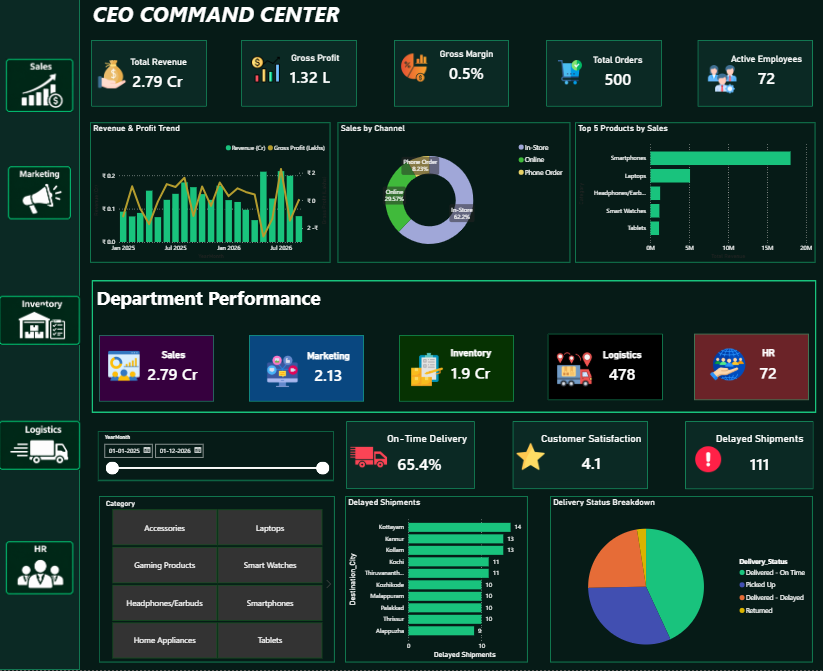
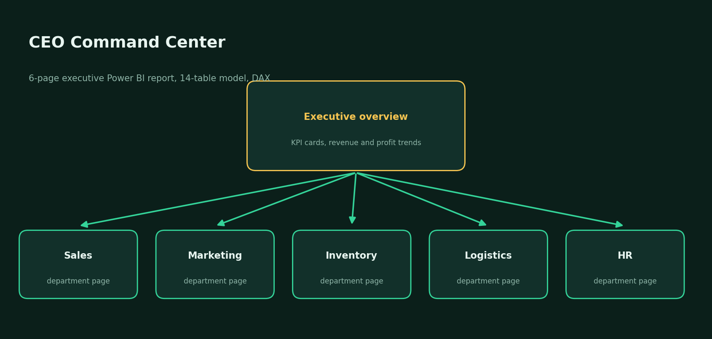

# CEO Command Center Dashboard

A 6-page executive Power BI report that gives a CEO one place to see Sales, Marketing, Inventory, Logistics and HR performance.

## Overview

The report opens on a CEO home page with five headline KPIs (revenue, orders, active employees, gross profit and margin) and a scorecard for all five departments. Each department has its own page with slicers and drill-down visuals. The design uses a dark theme, INR formatting and page navigation.

## Report structure

## Pages

| Page | What it shows |
|---|---|
| CEO home | 5 headline KPIs and a scorecard for all 5 departments |
| Sales | Average order value **₹55.72K**, sales growth **-6.5%** |
| Marketing | ROI **113.5%** on a **₹1.40 crore** budget across **7 channels** |
| Inventory | **8K** units, **45** low-stock, **6** out-of-stock |
| Logistics | **478** shipments, **65.4%** on time, **111** delayed |
| HR | **72 of 80** employees active, **10%** attrition, **91.9%** attendance |

## Data model

- **14 tables**, including **6 dimension tables**: Customer, Date, Employee, Product, Store, Warehouse
- A dedicated **DAX measures table**

## Tech stack

Power BI, DAX, Power Query, data modelling.

## Author

**Romy Avril Augustine**, Data Analyst, Kochi, India. 9 years of professional experience (since 2017) across finance operations and, now, analytics.
[LinkedIn](https://www.linkedin.com/in/romyavril/) | [Portfolio](https://romyavril96.github.io/Romy_Portfolio/) | insightswithromy@gmail.com
